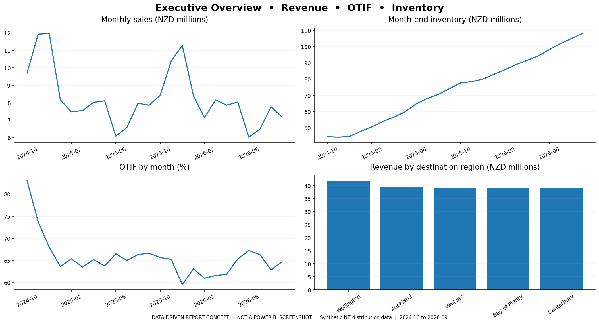
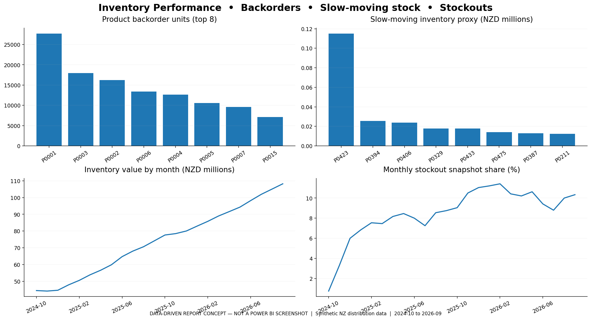
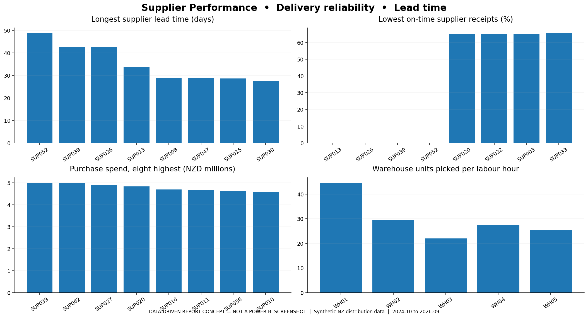
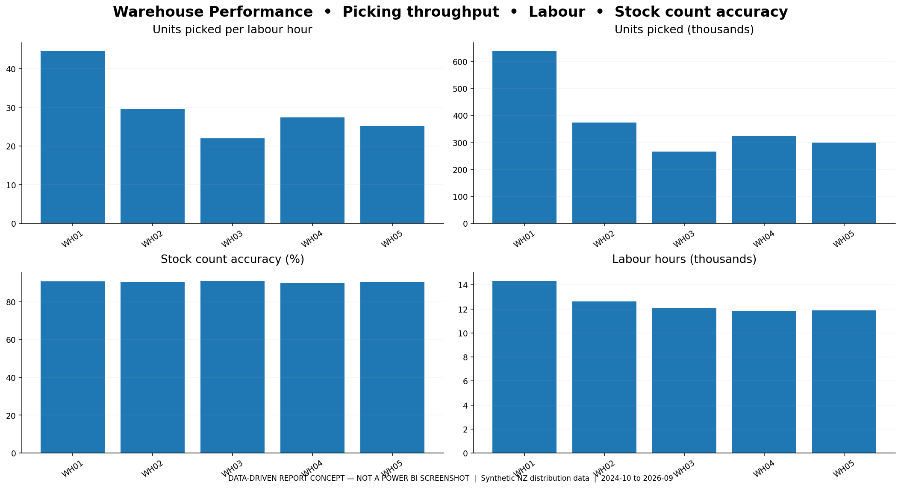
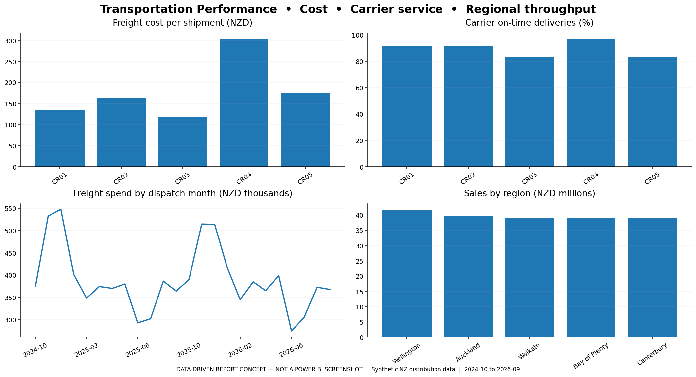
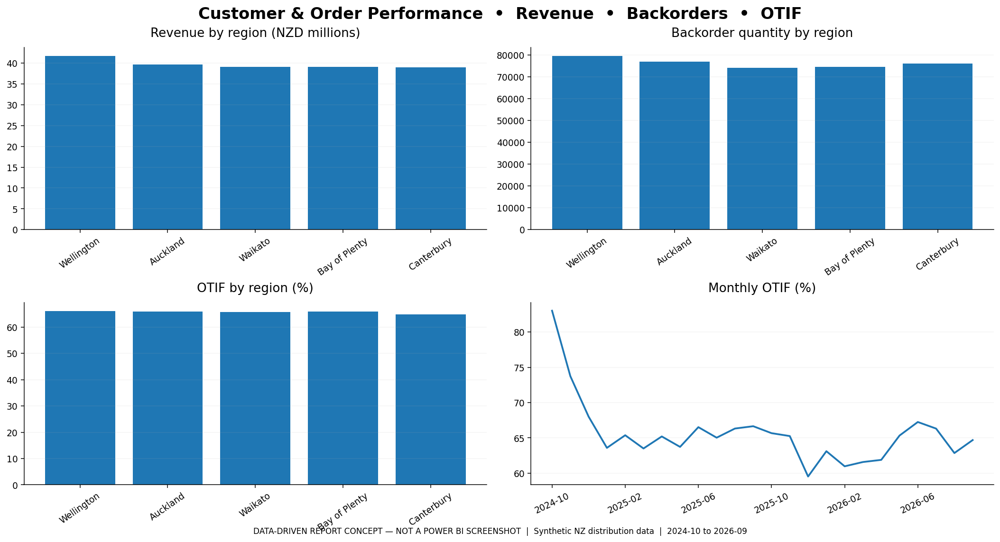

# End-to-End Supply Chain & Inventory Performance Dashboard



**Professional portfolio case study | New Zealand distribution scenario | 1 Oct 2024–30 Sep 2026**

> **Fictional, reproducible case study.** All customers, suppliers, material masters, plant codes, logistics results and financial metrics are **synthetic**. SAP-style fields are teaching analogues, not data extracted from any SAP environment. Report PNG files are **data-driven visual concepts**, not exported `.pbix` screenshots. A native Power BI project must be built following `powerbi/POWER_BI_BUILD_GUIDE.md`.

## Project overview

Design a realistic end-to-end supply chain, sales fulfilment, warehouse and inventory analytics solution demonstrating practical **Excel → SQL Server → Power BI** reporting, operations research and management improvement skills.

### Headline metrics (two-year simulated baseline)

| Measure | Audited result |
|---|---:|
| Sales orders | 63,500 |
| Order lines | 153,503 |
| Products / customers / suppliers / warehouses | 480 / 2,000 / 64 / 5 |
| Net sales | NZD 198,621,923.48 |
| Gross profit | NZD 53,843,788.85 |
| Gross profit margin | 27.11% |
| Delivered-order OTIF | 65.75% |
| Unit fill rate | 83.31% |
| Backordered units | 380,813 |
| Latest inventory valuation | NZD 108,194,990.59 |
| Annualised inventory turnover | 0.98× |
| Physical-stock exact match | 90.53% |
| Transportation cost | NZD 9,323,808.00 |

## Business problem and objectives

A fictional multi-region wholesale distributor struggles with (1) inventory shortages on popular products, (2) inventory funding pressure due to surplus stock, (3) differing supplier lead times, (4) warehouse throughput differences, (5) customer OTIF misses and (6) transport-cost/service tradeoffs. The analytical objectives are to define reliable KPIs, build a model that preserves **event grain**, identify exceptions and propose data-driven improvement experiments.

## Tools and skills

- **Microsoft Excel:** structured tables, KPI analysis, lookup exercises, PivotTable/slicer guide, conditional formatting and Power Query cleaning exercises.
- **SQL Server:** 17 typed relational source tables, PK/FK/indexes, CSV BULK INSERT, analytical views, beginner-to-advanced SQL, CTEs, window functions, KPI queries and stored procedure.
- **Power BI / DAX:** multi-fact star model, 30+ measures, date intelligence assumptions, 6-page visual blueprint, guidance to build a `.pbix` in Power BI Desktop.
- **SAP-style processes:** MM purchasing, material/plant/storage-location organisation, SD order/delivery concepts and movement types 101/601/561.
- **Operations and business analysis:** inventory valuation, service levels, supplier performance, warehouse throughput, transport cost and operational recommendations.

## Dataset & architecture

The generator `scripts/generate_dataset.py` creates deterministic, cross-linked transactional records using a fixed random seed (NumPy required). `data/raw/` is deliberately dirty on selected fields; `data/processed/` is canonical validated data. Inventory balances come from opening balances, actual simulated purchase receipts and capped dispatch issues. Two years of month-end snapshots are recorded. See [Data Dictionary](documentation/data_dictionary.md).

```text
Fictional system extracts (CSV) -- Power Query cleaning lab
           |                                |
      data/raw/                       data/processed/
                                            |
                                    SQL Server (17 tables)
                                            |
                                      Fact/Dim SQL views
                                            |
                                Power BI import + DAX model
                                            |
                                 Six-page report (build guide)
```

## Analytics / data cleaning

Run [data-cleaning lab](documentation/data_cleaning_playbook.md). Run `python scripts/validate_project.py` to repeat 17 integrity checks, including **all 57,600 inventory snapshots against their signed movement ledgers**. Reconciliation checks enforce IDs, unit accounting, nonnegative inventory and signed goods movements. Never claim that the generator's validated output was independently recovered from intentionally destroyed source values.

## SQL analysis and Power BI model

In SSMS run scripts in numeric order: `01_create_database`, `02_create_tables`, `03_import_processed_csv`, `04_build_star_views`, `05_sql_learning_and_analysis`, `06_kpi_queries`, `07_data_quality_and_dml_practice` (last two can be run independently for learning). Read [Data Model](documentation/data_model.md), [KPI Definitions](documentation/kpi_definitions.md) and [Power BI build guide](powerbi/POWER_BI_BUILD_GUIDE.md). **The SQL Server BULK INSERT absolute file path must be edited first.**

DAX measures live in [Supply_Chain_DAX_Measures.dax](powerbi/Supply_Chain_DAX_Measures.dax); Power Query example is in [PowerQuery_Raw_Orders_Cleanup.pq](powerbi/PowerQuery_Raw_Orders_Cleanup.pq). Currency is NZD and percentage calculations return 0–1 in DAX.

## Excel workbook

Open [Supply_Chain_Analysis.xlsx](excel/Supply_Chain_Analysis.xlsx) and begin at `START_HERE` and `Excel_Analysis`. Prebuilt formula-driven KPI blocks link to complete aggregate tables. A 450-order sample and 300-line sample support lookup/date exercises; **the full calculations use all 153,503 order lines via summary CSVs**, not the samples. Excel PivotTables/PivotCharts/Slicers require you to insert them in desktop Excel following `Excel_Methods` instructions, and are not supplied as native PivotTable objects.

## Dashboard page specifications

1. **Executive Overview:** net sales, gross profit, OTIF, inventory, backorders, freight and time series.
2. **Inventory Performance:** turnover, inventory valuation, stockout points, excess and slow-moving stock.
3. **Supplier Performance:** actual vs promised lead time, PO spend, on-time receipts, ranks.
4. **Warehouse Performance:** picking output, hours, units/hour and stock accuracy.
5. **Transportation Performance:** cost, carriers, region, mode and on-time tradeoffs.
6. **Customer & Order Performance:** OTIF, fill rate, customer/region sales and backorder exceptions.







## Actual findings from simulated data

- `P0001` has **27,713 backordered units** — a targeted replenishment candidate.
- `SUP052` averages **48.73 days** to receipt among completed PO lines.
- Warehouse `WH03` is lowest at **22.01 units/hour** — investigate comparable labour processes.
- Carrier `CR03` has lower typical cost, but **83.01% on-time service**, while premium `CR04` is costly and more reliable.
- `Canterbury` has the lowest regional **64.82%** delivered-order OTIF; `Wellington` has the largest total backorders.

Each report page includes at least five grounded management findings and a practical action proposal in [Business Insights](documentation/business_insights.md). These are simulated observations and hypotheses, not claims about actual organisations.

## Getting started / reproduce project

```powershell
# 1. Clone a public repository after uploading these project files
# git clone https://github.com/YOUR-USERNAME/supply-chain-inventory-performance-dashboard.git
cd supply-chain-inventory-performance-dashboard

# 2. (Optional) regenerate source data — Python 3.10+ and NumPy
python -m pip install numpy matplotlib
python scripts/generate_dataset.py
python scripts/build_sql.py
python scripts/build_reporting_assets.py
# Build the workbook with artifact_tool in a compatible Python environment:
python scripts/build_excel.py
```

Artifacts are included already; regeneration is optional. Note that the `artifact_tool` Python library used to build the Excel workbook may not be installed in all local environments, but the distributed `.xlsx` can be opened in ordinary Microsoft Excel.

## Project structure

```text
supply-chain-inventory-performance-dashboard/
├── README.md
├── data/
│   ├── raw/                         # source-like deliberate defects
│   └── processed/                   # 17 validated source CSVs + quality log
├── excel/
│   ├── Supply_Chain_Analysis.xlsx
│   └── *_Summary.csv               # source tables for Excel KPI exercises
├── sql/
│   └── 01–07_*.sql
├── powerbi/
│   ├── Supply_Chain_DAX_Measures.dax
│   ├── PowerQuery_Raw_Orders_Cleanup.pq
│   └── POWER_BI_BUILD_GUIDE.md
├── screenshots/
│   └── six *_preview.png graphics  # NOT real Power BI screenshots
├── scripts/
│   └── reproducible Python build scripts
├── documentation/
│   ├── data_dictionary.md
│   ├── kpi_definitions.md
│   ├── data_model.md
│   ├── data_cleaning_playbook.md
│   ├── business_insights.md
│   ├── validated_metrics.json
│   └── analysis_summary.json
└── linkedin/
    └── profile_kit.md
```

## Publishing and attribution

See [GitHub upload instructions](documentation/github_upload_guide.md) and [LinkedIn / CV kit](linkedin/profile_kit.md). All names and figures are fictional. Avoid suggesting enterprise SAP or a production Power BI deployment was performed. Add your actual `.pbix` only after building it in Power BI Desktop.

## Skills demonstrated

Supply Chain & Logistics Analytics • Inventory Analysis • Procurement and Supplier Analysis • Warehouse Operations • Transportation Analysis • Advanced Excel • SQL Server • Power Query • Power BI modelling and DAX design • Data Cleaning • Star Schema • SAP-style Operational Data • KPI Design • Exception Reporting • Operational Improvement • Business Insights • Reproducible Python Simulation
