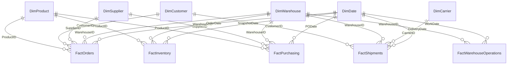

# Logical data model and integrity design

The production layer has 17 ordinary relational source tables, physical PK/FK definitions and indexes in `sql/02_create_tables.sql`. Its Power BI star consumption layer is produced by `sql/04_build_star_views.sql`.

## Fact-table grain and duplication protections

| View | Record grain | Measures | Common mistake |
|---|---|---|---|
| FactOrders | One sales-order line | Sales, gross profit, shipped/backordered units | COUNTROWS as orders (counts lines instead) |
| FactInventory | One product × warehouse × month-end | Closing stock value, point stockout flags | SUM of stock across 24 months |
| FactPurchasing | One PO line | Purchase value, received lead times | Late vs not received confusion |
| FactShipments | One shipment (= one dispatched order) | Freight, on-time, in-full, cycle days | Joining one shipment with several order lines and duplicating cost |
| FactWarehouseOperations | One warehouse × day × shift | Units and lines picked, labour hours | Arithmetic average of shift productivity |
| FactStockCounts | One count event | Exact match rate | Counting missing records as correct |

A `DimDate` relationship must be one-to-many, single direction, DATE typed and marked as the date table in Power BI. Role-playing dates (OrderDate, ShipDate, DeliveryDate, PODate, GoodsReceiptDate) require disconnected role-play dimension copies or inactive relationships combined with `USERELATIONSHIP` where appropriate. Set the desired KPI event-date semantics explicitly; never filter separate facts through each other with arbitrary bidirectional relationships.

`DimRegion` means CUSTOMER DESTINATION Region for sales/shipment pages. `DimWarehouse[Region]` means ORIGIN Region. Do not make a single 'region' relationship that ambiguously mixes origins and destinations. `SalesTargets` has composite YearMonth × Region grain and must use a key bridge or TREATAS measure (not a many-to-many raw calendar month join).

## Expected cardinalities

There are 63,500 unique order headers; 153,503 distinct order-line IDs; 480 product keys; 2,000 customer keys; 64 supplier keys; 5 warehouse keys; 24 × 480 × 5 = 57,600 snapshot rows. Foreign-key references are generated from master domains rather than randomly free-typed strings.
